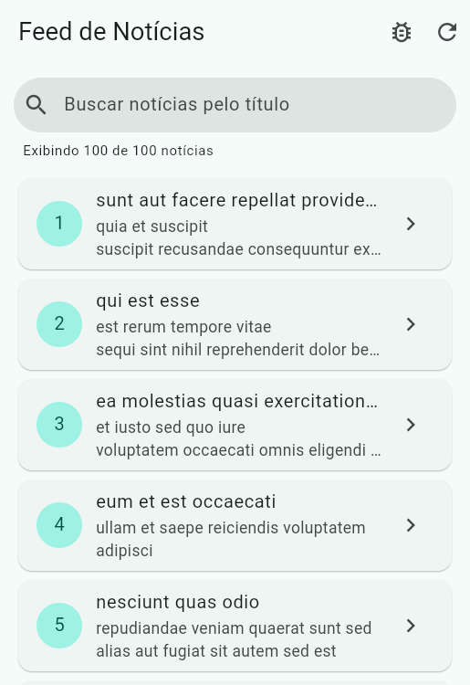
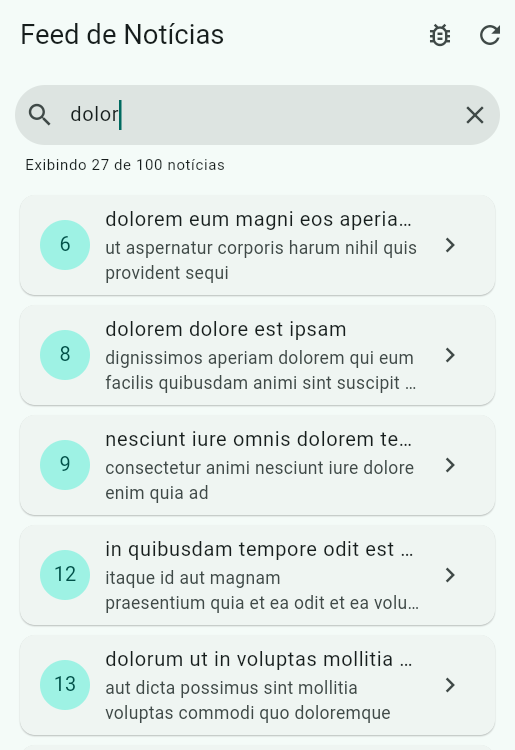
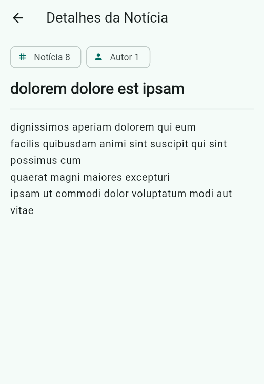
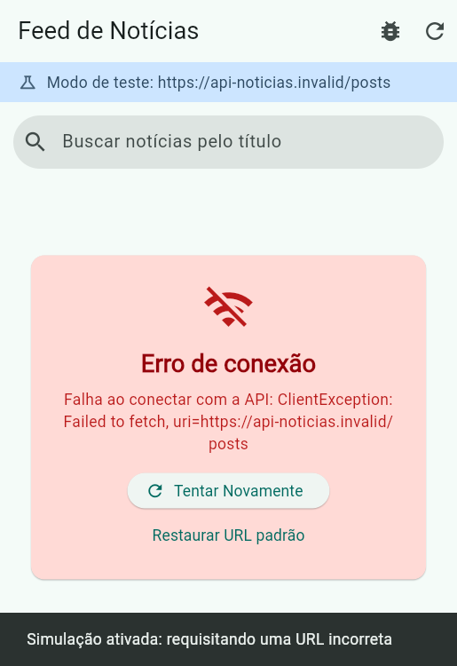
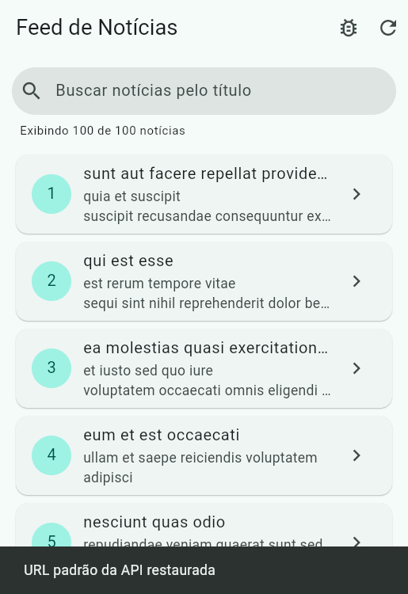

# PDM Aula 10 — Consumo Avançado de APIs, Listas e Exceções

Roteiro prático da disciplina **Programação para Dispositivos Móveis I** (Semestre 2026/2) —
Aula 10: *Iteração de Listas JSON, StatusCode e Try/Catch*.

Feed de notícias que consome uma lista JSON remota
([JSONPlaceholder `/posts`](https://jsonplaceholder.typicode.com/posts)), converte cada item em um
`NoticiaModel` com `jsonDecode()` + `List.map()`, valida o `response.statusCode` e trata falhas de rede
com `try / catch / finally`. A tela controla os **4 estados essenciais**: Carregando, Sucesso, Vazio e
Erro de Conexão.

## Arquitetura

| Diretório / Arquivo | Responsabilidade | Conceitos aplicados |
|---|---|---|
| `lib/models/noticia_model.dart` | Classe `NoticiaModel` com `factory fromJson` e valores padrão (`??`) | Modelagem, desserialização JSON |
| `lib/services/noticia_service.dart` | Requisição HTTP, validação do `statusCode == 200` e conversão da lista | `http.get`, `jsonDecode`, `List.map`, `try/catch`, `throw Exception` |
| `lib/screens/feed_noticias_screen.dart` | Tela principal com os 4 estados, filtro de busca e simulação de erro | `StatefulWidget`, `setState`, `try/catch/finally`, `ListView.builder`, `Card`, `ListTile` |
| `lib/screens/detalhe_noticia_screen.dart` | Título e texto completo da notícia selecionada | `Navigator.push`, `MaterialPageRoute`, `SingleChildScrollView` |
| `lib/main.dart` | Ponto de entrada, `MaterialApp` e tema | Material Design 3, `colorSchemeSeed` |

```
lib/
├── main.dart
├── models/
│   └── noticia_model.dart
├── screens/
│   ├── detalhe_noticia_screen.dart
│   └── feed_noticias_screen.dart
└── services/
    └── noticia_service.dart
```

### Os 4 estados da tela

| Estado | Condição | O que a interface exibe |
|---|---|---|
| **Carregando** | `_carregando == true` | `CircularProgressIndicator` centralizado |
| **Erro de Conexão** | `_erro != null` (exceção capturada no `catch`) | Card de erro com a mensagem e o botão **Tentar Novamente** |
| **Vazio** | API respondeu `200` com lista vazia, ou a busca não encontrou nada | Ícone e mensagem explicativa |
| **Sucesso** | Lista preenchida | `ListView.builder` com `Card` + `ListTile` |

O bloco `finally` sempre desliga o `_carregando`, com sucesso ou com erro, então a interface nunca
fica presa no loading.

## Desafios de laboratório implementados

Os três níveis foram resolvidos:

| Nível | Desafio | Implementação |
|---|---|---|
| **Básico** | Filtro de Busca Local | `TextField` no topo da tela filtra a lista já carregada pelo título, em tempo real e sem nova requisição (getter `_noticiasFiltradas`). Mostra o contador "Exibindo X de Y notícias", botão de limpar e estado vazio próprio para busca sem resultado |
| **Intermediário** | Navegação para Detalhes | Tocar em um card chama `Navigator.push` com `MaterialPageRoute` e abre a `DetalheNoticiaScreen`, que recebe o `NoticiaModel` pelo construtor e exibe título e texto completo |
| **Avançado** | Simulação de Erro de Conexão | Botão de teste (ícone de inseto na `AppBar`) troca a URL da API por `https://api-noticias.invalid/posts` (domínio `.invalid` nunca resolve no DNS). A UI exibe o card de erro com **Tentar Novamente** e **Restaurar URL padrão**, além de uma faixa indicando o modo de teste |

## Evidências

Capturas do app rodando no navegador (Flutter Web) consumindo a API real.

| Feed com `ListView.builder` | Básico — filtro por título | Intermediário — detalhes |
|---|---|---|
|  |  |  |
| 100 notícias carregadas da API | "dolor" filtra 27 de 100 notícias | Notícia 8 com título e texto completo |

| Avançado — erro de conexão simulado | Avançado — URL restaurada |
|---|---|
|  |  |
| `ClientException` capturada pelo `try/catch` e exibida no card de erro | Lista recarregada ao voltar para a URL correta |

## Como executar

```bash
flutter pub get
flutter run
```

## Testes

São 10 testes. A API é simulada com o `MockClient` do pacote `http` (injetado no `NoticiaService`),
então os testes não dependem da internet. Eles cobrem o modelo, o serviço (status `200`, status de
erro e falha de rede), os 4 estados da tela e os três desafios:

```bash
flutter test
```

```
00:05 +10: All tests passed!
```

## Ajustes em relação ao código do roteiro

- **Endpoint real:** o placeholder `api_noticias_endpoint` foi substituído pela API pública do
  JSONPlaceholder, cujos campos (`id`, `userId`, `title`, `body`) batem com o `fromJson` do roteiro.
- **Estado Vazio:** o roteiro cita 4 estados, mas o código só tratava 3. Foi incluído o estado Vazio.
- **Mensagem de erro:** o `replaceAll('Exception: ', '')` do roteiro cortava o meio de
  `ClientException: `, gerando "ClientFailed to fetch". A troca passou a usar `RegExp(r'\bException: ')`.
- **`mounted`:** os `setState` após o `await` verificam `mounted`, evitando erro se a tela for
  fechada durante a requisição.
- **Injeção do `http.Client`:** o serviço aceita um `client` opcional, que os testes usam para injetar
  o `MockClient`.

## Histórico de commits

O versionamento segue o padrão de **commits semânticos** (Conventional Commits):

```
chore: inicializa projeto Flutter pdm_aula10_consumo_api
feat: cria modelo e servico de noticias com tratamento de excecoes
feat: implementa FeedNoticiasScreen com ListView.builder e indicador de loading
feat: adiciona filtro de busca local por titulo em tempo real (Desafio Basico)
feat: abre DetalheNoticiaScreen com Navigator.push ao tocar no card (Desafio Intermediario)
feat: adiciona botao de teste que simula erro de conexao com URL incorreta (Desafio Avancado)
test: cobre modelo, servico, estados do feed e os tres desafios com MockClient
fix: preserva nomes como ClientException ao limpar a mensagem de erro
docs: adiciona README com arquitetura e evidencias de execucao
```
